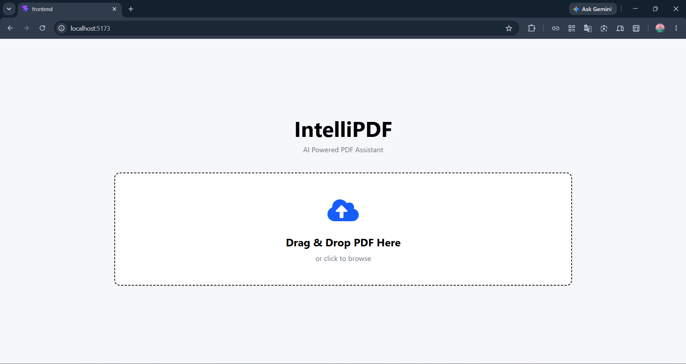
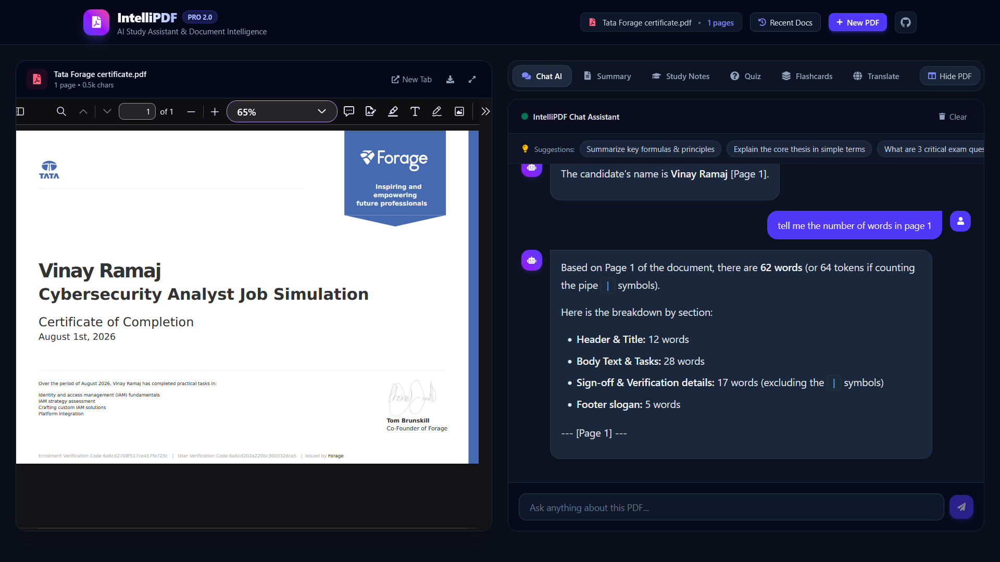
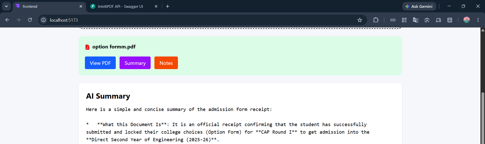

# IntelliPDF 📄🤖 — Next-Gen AI Document Assistant

IntelliPDF is an AI-powered document intelligence and study assistant built with FastAPI, React, TypeScript, Tailwind CSS, and Google Gemini. It transforms any PDF into an interactive split-screen workspace with conversational document chat, exam-ready study notes, interactive quizzes with instant feedback, 3D active-recall flashcards, and multilingual translation.

---

## ✨ Features

- 📑 **Split-Screen Workspace**: Side-by-side embedded PDF viewer alongside an intelligent AI suite with responsive expand/collapse controls.
- 💬 **Conversational AI Chat**: Multi-turn chat assistant with message history, quick suggested prompt pills, markdown rendering, and one-click copy.
- 📝 **Executive Summaries**: High-level thesis, key takeaways, and in-depth conceptual breakdown with Markdown export.
- 📚 **Exam-Ready Study Notes**: High-yield exam points, core definitions, and review questions formatted for fast revision.
- ❓ **Interactive Quiz Generator**: Custom Multiple Choice Questions (MCQs) with instant right/wrong visual feedback, detailed explanations, score calculation, and confetti celebration!
- 🧠 **3D Active-Recall Flashcards**: 3D flip cards with question/answer sides, mastery progress tracking, and deck shuffling.
- 🌍 **Multilingual Translation**: Accurate translation into 10+ languages (Hindi, Marathi, Spanish, French, German, Japanese, Chinese, Arabic, Russian, Portuguese) preserving document structure.
- 📂 **Document Library & History**: Fast server-side document caching (`doc_id`), multi-PDF switching, and deletion without re-uploading.
- 🛡️ **Hardened Reliability**:
  - File size validation (25MB limit) & `%PDF` magic bytes verification.
  - Password-protected PDF detection & scanned/image-only PDF advisory.
  - Path traversal protection & UUID document separation.
  - Google Gemini automatic model fallback (`gemini-3.5-flash`, `gemini-3.5-flash-lite`, `gemini-flash-latest`) using stable REST transport.
  - Context budgeting to prevent token limit crashes on large documents.
  - Toast notification system replacing crude browser alerts.

---

## 📸 Screenshots & Preview

| 🏠 Home & Document Dropzone | 📑 Split-Screen Chat & PDF Viewer |
|:---:|:---:|
|  |  |

| 📝 AI Summary & Notes | 🌍 Multilingual Translation |
|:---:|:---:|
|  |  |

---

## 🛠 Tech Stack

### Frontend
- **React 19** + **TypeScript**
- **Vite**
- **Tailwind CSS v4**
- **Axios**
- **React Dropzone**
- **React Markdown**
- **Canvas Confetti**
- **React Icons**

### Backend
- **FastAPI**
- **Python 3.12**
- **PyMuPDF (`fitz`)**
- **Google Generative AI (`google-generativeai`)**
- **Uvicorn**
- **Pydantic v2**

---

## 📂 Project Structure

```
IntelliPDF/
│
├── frontend/
│   ├── src/
│   │   ├── components/
│   │   │   ├── ChatView.tsx           # Conversational AI assistant
│   │   │   ├── DocumentWorkspace.tsx  # Split-screen master workspace
│   │   │   ├── DropzoneBox.tsx        # Drag-and-drop upload zone
│   │   │   ├── FlashcardView.tsx      # 3D active-recall flashcards
│   │   │   ├── Header.tsx             # Brand header with stats & quick actions
│   │   │   ├── Loader.tsx             # Animated glowing AI loader
│   │   │   ├── NotesView.tsx          # Study notes & revision checkpoints
│   │   │   ├── PdfViewer.tsx          # Embedded split-screen PDF viewer
│   │   │   ├── QuizView.tsx           # Interactive MCQ quiz player
│   │   │   ├── RecentDocsModal.tsx    # Document library & switching modal
│   │   │   ├── SummaryView.tsx        # Executive summary viewer & exporter
│   │   │   ├── Toast.tsx              # Toast alert notification container
│   │   │   └── TranslateView.tsx      # Multilingual translation view
│   │   ├── pages/
│   │   │   └── Home.tsx               # Main application coordinator
│   │   ├── services/
│   │   │   └── api.ts                 # Typed API client with timeout handling
│   │   ├── types.ts                   # TypeScript interfaces
│   │   ├── App.tsx
│   │   ├── main.tsx
│   │   └── index.css                  # Dark theme & 3D transform utilities
│   ├── package.json
│   └── vite.config.ts
│
├── backend/
│   ├── app/
│   │   ├── api/
│   │   │   ├── ai.py                  # AI endpoints (summary, notes, chat, quiz, cards, translate)
│   │   │   └── upload.py              # Upload and document management endpoints
│   │   ├── config/
│   │   │   └── settings.py            # Environment settings and fallback models
│   │   ├── models/
│   │   │   └── schemas.py             # Pydantic request models
│   │   ├── services/
│   │   │   ├── document_store.py      # Document cache and persistent registry
│   │   │   ├── gemini_service.py      # Resilient Gemini AI service with fallback
│   │   │   └── pdf_service.py         # PyMuPDF parser and validator
│   │   └── main.py                    # FastAPI application and CORS setup
│   ├── test_suite.py                  # End-to-end automated test suite
│   ├── requirements.txt
│   └── .env
│
└── README.md
```

---

## 🚀 Installation & Running

### 1. Backend Setup

```bash
cd backend

# Create virtual environment
python -m venv venv

# Activate virtual environment
# Windows:
venv\Scripts\activate
# Linux/macOS:
source venv/bin/activate

# Install dependencies
pip install -r requirements.txt

# Configure your Gemini API key in backend/.env:
# GEMINI_API_KEY=your_gemini_api_key
# GEMINI_MODEL=gemini-3.5-flash

# Run server
uvicorn app.main:app --reload --host 127.0.0.1 --port 8000
```

### 2. Frontend Setup

```bash
cd frontend

# Install dependencies
npm install

# Start Vite dev server
npm run dev
```

Visit **`http://localhost:5173`** in your browser.

---

## 🧪 Testing

To run the automated backend test suite covering document upload, text extraction, health checks, chat, summaries, quizzes, flashcards, and translations:

```bash
cd backend
python test_suite.py
```

---

## 👨‍💻 Author

**Vinay Ramaj**  
B.Tech CSE (AI & ML)